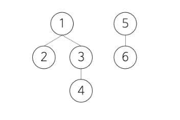
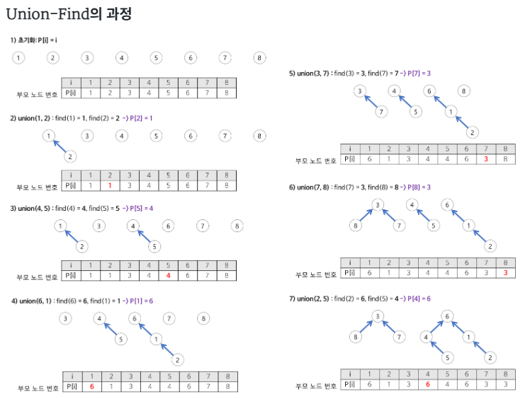
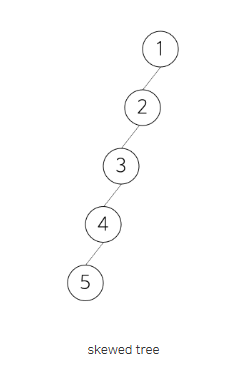
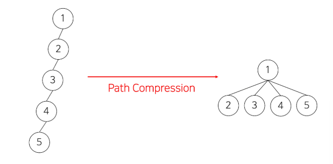

## Union Find
- **서로소 집합**(Disjoint Set)을 표현할 때 사용하는 알고리즘
- 서로소 집합 : 공통 원소가 없는 부분 집합들
    - 서로소 O : `{1, 2}`, `{3, 4}`
    - 서로소 X : `{1, 2}`, `{2, 4}` (2가 겹침)
- 자료구조 : 주로 트리 구조 사용 (배열, 연결 리스트 등도 활용 가능)
- 핵심 연산 두 가지
    - `find(x)` : x가 속한 집합의 대표(루트 노드)를 찾음
    - `union(x, y)` : x와 y가 속한 두 집합을 하나로 합침


---
## Union Find 트리로 표현하기


---
## Union Find 과정 이해하기



---
## Python으로 구현하기

```python
# 초기화 : 각 원소가 자기 자신만 가진 집합이 되도록 부모를 자기 자신으로 설정
def init(n):
    parent = [i for i in range(n + 1)]
    return parent

# 탐색 : x의 루트 노드를 찾음. 루트 노드가 그 집합의 대표값이 됨
def find(x):
    if parent[x] != x:
        return find(parent[x])
    return x

# 합치기 : 두 원소의 루트를 찾고, 한쪽 루트를 다른 쪽 루트 밑에 붙임
def union(x, y):
    x = find(x)
    y = find(y)

    if x > y:          # 번호가 더 작은 루트를 대표로 삼음
        parent[x] = y
    else:
        parent[y] = x
```

```python
parent = init(5)

union(1, 4)
union(4, 2)

print(parent)  # [0, 1, 1, 3, 1]
```

### 이 방식의 시간 복잡도

- 위처럼 트리가 한쪽으로 길게 늘어지면(편향 트리), `find` 한 번에 최대 **O(N)** 이 걸림
- 파이썬은 기본 재귀 한도가 1000이라, 트리가 깊으면 `RecursionError`가 발생할 수 있음

---
### => 해결법 : 경로 압축 (Path Compression)

**한 줄 요약 : `find`로 루트를 찾고 돌아오는 길에, 거쳐 간 노드들을 전부 루트에 바로 연결한다.**

예시 : `5 → 4 → 3 → 2 → 1(루트)` 인 상태에서 `find(5)` 호출

1. 재귀로 부모를 따라 올라가며 루트 `1`을 찾음
2. 재귀가 끝나고 돌아오면서, 지나온 노드들의 부모를 모두 `1`로 바꿈
    - `parent[2] = 1`, `parent[3] = 1`, `parent[4] = 1`, `parent[5] = 1`
3. 결과 : 모든 노드가 루트 `1`에 직접 붙음 → 다음 `find`부터는 한 번에 루트 도착

```
압축 전                 압축 후
1 ← 2 ← 3 ← 4 ← 5           1
                        ↗ ↗ ↖ ↖
                       2  3  4  5
```

```python
def init(n):
    parent = [i for i in range(n + 1)]
    return parent

# 경로 압축 : 찾은 루트를 parent[x]에 저장하고 반환
def find(x):
    if parent[x] != x:
        parent[x] = find(parent[x])  # 바뀐 부분! 루트를 내 부모로 바로 지정
    return parent[x]


def union(x, y):
    x = find(x)
    y = find(y)

    if x > y:
        parent[x] = y
    else:
        parent[y] = x
```

- 위처럼 트리 높이가 낮아져, `find`의 평균 시간 복잡도가 **O(log N)** 수준으로 줄어듦
- 참고 : 처음 한 번은 여전히 긴 경로를 재귀로 따라가야 하므로, N이 매우 크면 `sys.setrecursionlimit()`으로 재귀 한도를 늘려 두는 것이 안전함
